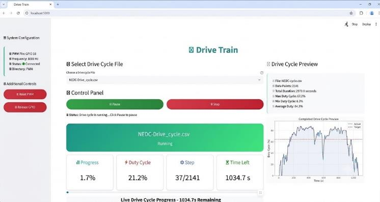
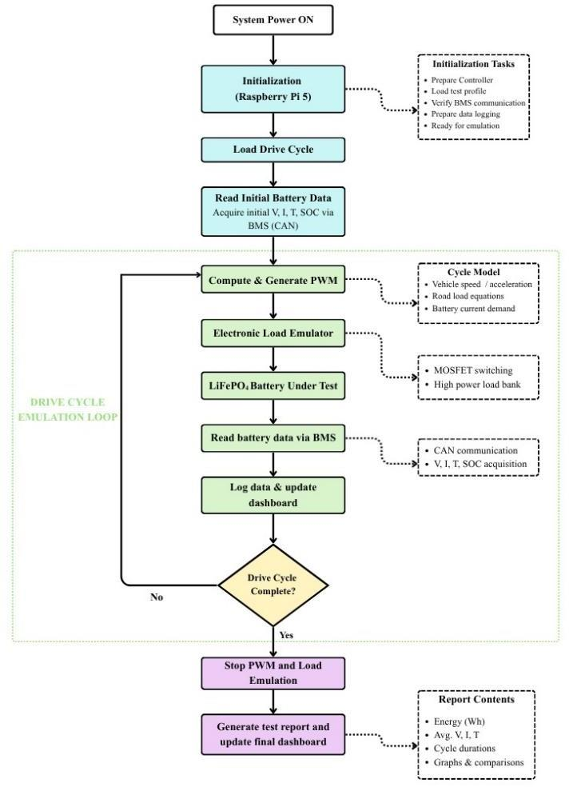
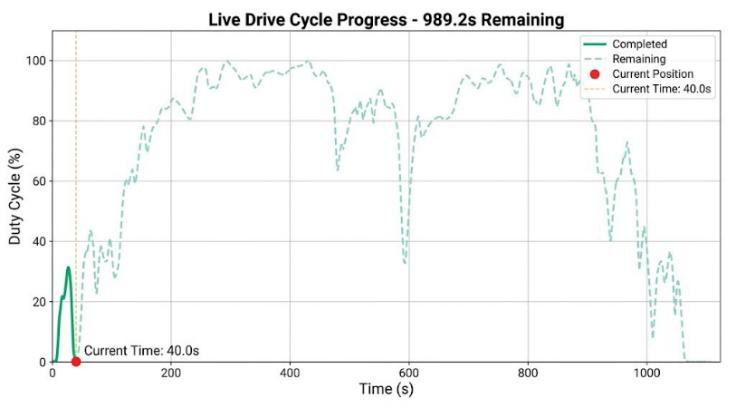

# EV Battery Testing and Drive Cycle Digital Twin Platform

A compact bench system that tests an electric vehicle battery with real driving patterns, without needing a car. A Raspberry Pi 5 plays a standard drive cycle (UDDS, WLTP, HWFET) as a PWM signal, a PWM-controlled electronic load draws the matching current from the battery, and a local dashboard shows the test live. Everything runs on the Pi, with no cloud or internet connection.



## What is in this repository

- `drive_train_dashboard.py`: the Streamlit dashboard that picks a drive cycle and plays it as a PWM signal on GPIO 18.
- `bms_logger.py`: reads voltage, current, SOC and temperature from the BMS over CAN, filters them and saves a CSV log.
- `duty_cycles/`: 15 ready-to-play drive cycle files.
- `docs/`: the system flowchart and dashboard screenshots.

The load emulator described below is hardware, so it has no code here.

## Why this project

Standard lab tests usually draw a constant or stepped current. A real vehicle does not: current rises during acceleration, levels out while cruising and drops during braking. Testing on a real car or a chassis dynamometer is expensive and slow to repeat. This setup reproduces those current patterns on a bench so the same test can be run again and again on a battery pack.

## How it works

1. The drive cycle files (Excel, `.xlsx`) are stored on the Raspberry Pi, in the `duty_cycles` folder.
2. The user picks a drive cycle from the dashboard drop-down.
3. For every time step, the Pi converts the demanded current into a PWM duty cycle:

   `D(t) = I_aem(t) / I_max x 100%`

   where `I_aem(t)` is the demanded current at time `t` and `I_max` is the maximum rated current of the load.
4. The Pi outputs that PWM signal on GPIO 18 (3.3 V logic, 1 kHz) to the electronic load emulator.
5. The load emulator draws the matching current from the battery. This reproduces the acceleration, cruising and braking phases of the cycle.
6. The battery's own Battery Management System (BMS) reports voltage, current and temperature over the CAN bus. Each reading is filtered and stored with a timestamp.
7. The dashboard shows live progress of the cycle. When it ends, the PWM output is switched off.



## Algorithm on the Raspberry Pi 5

1. Power on. Initialize the BMS communication, the GPIO pins and the drive cycle files on the SD card.
2. The user selects a drive cycle from the drop-down menu.
3. The cycle data is loaded into memory and execution starts.
4. Read battery voltage V(t), current I(t) and temperature T(t) from the BMS (`bms_logger.py`).
5. Compute the PWM duty cycle `D(t) = I_aem(t) / I_max`.
6. Set the GPIO PWM output to that duty cycle.
7. The electronic load applies the demanded current to the battery.
8. Log the timestamp, V(t), I(t), T(t) and D(t) to the SD card, then refresh the dashboard.
9. If the cycle is not finished, move to the next time step and repeat from step 4.
10. At the end, close the log file and switch the PWM output off.

## Hardware

| Component | Specification |
|---|---|
| Controller | Raspberry Pi 5 (8 GB RAM) |
| Battery under test | 96 V LiFePO4 pack with integrated BMS |
| Load | PWM-controlled electronic load with a high-power resistor array |
| Cooling | Aluminium heat sink and a 12 V fan |
| PWM output | GPIO 18, 1 kHz |
| BMS link | CAN bus |
| Storage | 64 GB SD card in the Raspberry Pi 5 |
| Dashboard | Streamlit, running on the Raspberry Pi 5 |

**Load emulator.** The Pi's 3.3 V PWM signal switches a power transistor arranged as a buck converter. When the transistor is on, current flows through a high-value resistive load. When it is off, a diode keeps the current flowing so it does not drop abruptly.

## Drive cycles

The `duty_cycles` folder holds 15 ready-to-play files. The dashboard lists every `.xlsx` file in that folder.

| Files | What they are | Length |
|---|---|---|
| `CHINA1` to `CHINA10` | Ten China-style urban driving cycles | 22 to 30 minutes each |
| `EPAFTP`, `EPAFTP2`, `EPAFTP3`, `EPAFTP4` | The EPA FTP-75 cycle, the full run and three shorter parts | 9 to 31 minutes |
| `WOT` | Wide-open throttle, a short burst of hard acceleration | 40 seconds |

Each file has a header row followed by one row per time step:

| Column | Meaning |
|---|---|
| `time` | Time in seconds (every 0.5 s, and every 0.05 s for `WOT`) |
| second column | Demanded current in amps (its header is the cycle name) |
| `DUTY CYCLE` | The same demand as a percentage of the load's maximum current |

The duty cycle column is what the Raspberry Pi plays out. To add a new cycle, create an `.xlsx` file with a `time` column and a duty cycle column and drop it in the folder.

The first test runs on the battery pack used the standard UDDS, WLTP and HWFET cycles (see Results). Cycle data of this kind can be generated with the Drive Cycle Source block of the Powertrain Blockset Drive Cycle Data add-on in MATLAB Simulink.

**How the Pi plays a file.** The dashboard scales the chosen file so that its highest point is full duty (100%), then steps through the rows, holding each value for the time gap to the next row.

## Dashboard

The dashboard is built with Streamlit and runs locally on the Pi. It has:

- A drop-down to choose the drive cycle file.
- A preview plot of the whole drive cycle before the test starts.
- A Start button that turns into Pause and Resume while the cycle runs, plus Stop, Reset PWM and Release GPIO buttons.
- Live values: progress, duty cycle, step number and time left.
- File details such as data points, total duration and the maximum, minimum and average duty.
- A live plot of the duty cycle against time, with the completed part of the cycle highlighted.



## Telemetry

`bms_logger.py` talks to the battery's DALY BMS over CAN (250 kbit/s, extended IDs) and runs next to the dashboard on the Pi:

- It sends a request for data ID `0x90` (pack voltage, current, SOC) and `0x92` (maximum and minimum temperature) every second.
- The raw values are decoded to volts, amps, percent and degrees Celsius. Current is stored with an offset of 30000, and temperature with an offset of 40.
- Packets that are missing or fall outside sensible limits are dropped, and a median of the last five readings removes single-packet spikes.
- Each cleaned reading is saved to a CSV file with a timestamp, so it can be analysed later without an internet connection.

```
sudo ip link set can0 up type can bitrate 250000
python bms_logger.py --channel can0 --out logs/test_run.csv
```

Press Ctrl+C to stop, or use `--duration 600` to stop after ten minutes. The message layout follows the DALY CAN communications protocol (V1.0). The decoding and filtering were checked against simulated frames, so on a new pack it is worth comparing the printed values with the BMS display first.

## Results

The system was tested on the LiFePO4 pack at room temperature (about 25 °C) with UDDS, WLTP and HWFET.

- The electronic load tracked the required current profile of each cycle, including the acceleration peaks, steady cruising currents and braking intervals.
- **Repeatability:** UDDS was run 3 times on the same battery. The current profiles matched within **0.3 A** of each other.
- **Thermal behaviour:** during WLTP, the longest test, the heat sink and fan kept the temperature within safe limits.
- **SOC behaviour:** the aggressive acceleration and high current drain of WLTP caused a sharper SOC discharge than HWFET.
- Voltage, current and temperature were saved as CSV files for later analysis.

## Limitations and future work

- Tested on one battery pack, at room temperature only.
- Future work: higher-power battery packs, programmable custom drive cycles, testing several cells or packs at once, and more specialised battery monitoring features.

## Running the dashboard

On the Raspberry Pi 5:

```
pip install -r requirements.txt
streamlit run drive_train_dashboard.py
```

The dashboard drives GPIO 18 through `gpiozero` with the `lgpio` pin factory, which is what the Raspberry Pi 5 needs. It will not start on a computer without those GPIO libraries.

## Folder structure

```
.
├── README.md
├── drive_train_dashboard.py
├── bms_logger.py
├── requirements.txt
├── duty_cycles/
│   ├── CHINA1.xlsx ... CHINA10.xlsx
│   ├── EPAFTP.xlsx ... EPAFTP4.xlsx
│   └── WOT.xlsx
└── docs/
    ├── system_flowchart.png
    ├── dashboard_drive_cycle_selection.png
    └── live_drive_cycle_progress.png
```
